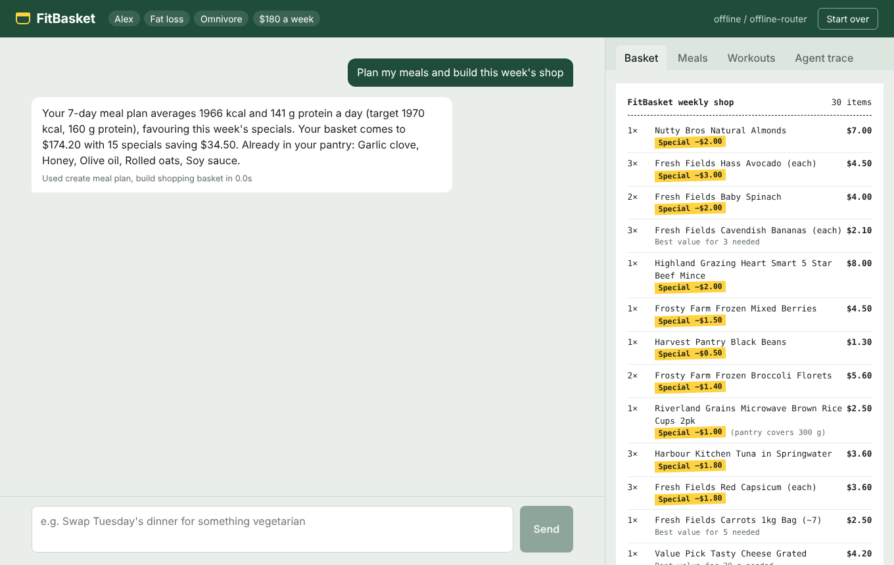
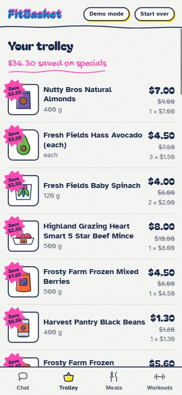
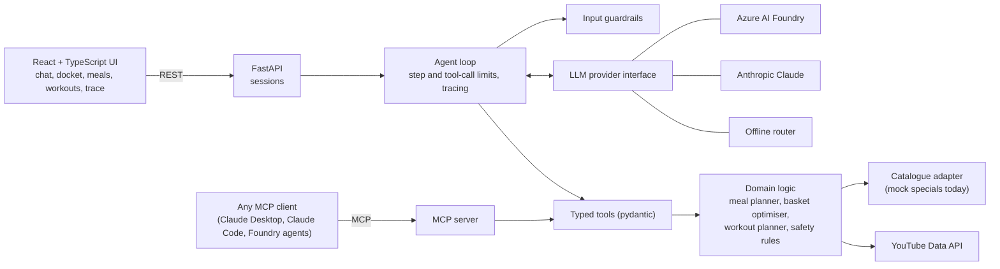

# FitBasket

An AI personal trainer and grocery agent. Tell it your goal, allergies, budget and the days you train, and it:

1. **Plans a week of meals** that hit your calorie and protein targets.
2. **Builds your weekly shop** from that plan: it subtracts what's already in your pantry, picks the cheapest safe packs, uses this week's specials and sticks to the brands you prefer, then checks the total against your budget.
3. **Plans your workouts** around your schedule and sport days. Every exercise has a hand-picked how-to video that plays inline, and a follow-along mode steps through a session one exercise at a time. Weeks with three or more game days get shorter sessions and a recovery day instead of extra conditioning.

It's a tool-using LLM agent with guardrails, an eval suite and tracing, built to production habits rather than as a notebook demo. It runs on **Azure AI Foundry (Azure OpenAI)** or **Anthropic Claude**, and fully offline with no API key.



## Use it on your phone

**Live app: https://bunki-dev.github.io/fitbasket/**

Open it on your phone and add it to your home screen (iPhone: Safari > Share > Add to Home Screen; Android: Chrome > menu > Install app). It opens full screen like an installed app.

There's no server: GitHub Pages hosts the app, and the same Python agent runs **inside your phone's browser** with [Pyodide](https://pyodide.org) (Python compiled to WebAssembly) in a Web Worker. The first launch downloads the Python runtime (about 10 MB); after that it's cached and works offline. Your profile, plan, basket and chat are saved on your device.

It starts in **Demo mode** (the offline router, no AI model). Tap **Demo mode** in the top bar to switch to Claude or Azure AI Foundry with your own API key. The key is stored only in that browser on that device and sent only to the provider you choose, so use a key with a spending limit.

<p align="center"></p>

## Quick start (local server)

```bash
# API + agent
python -m venv .venv && source .venv/bin/activate
pip install -e ".[dev,all]"
uvicorn fitbasket.api:app --reload          # http://localhost:8000/api/health

# Web UI (second terminal)
cd web && npm install && npm run dev         # http://localhost:5173
```

Or run everything in one container: `docker compose up --build`, then open http://localhost:8000.

With no keys set, the agent uses the **offline provider**, a deterministic keyword router that stands in for the model so the whole app, tests and evals run anywhere. To use a real model, copy `.env.example` to `.env` and set:

| Backend | Settings |
|---|---|
| Azure AI Foundry / Azure OpenAI | `LLM_PROVIDER=azure`, `AZURE_OPENAI_ENDPOINT`, `AZURE_OPENAI_API_KEY`, `AZURE_OPENAI_DEPLOYMENT` |
| Anthropic Claude | `LLM_PROVIDER=anthropic`, `ANTHROPIC_API_KEY`, optionally `ANTHROPIC_MODEL` |
| Extra YouTube results | `YOUTUBE_API_KEY` (curated videos always come first; free-text searches without a key link to a YouTube search, never an invented video) |

Other ways in: `fitbasket` for a terminal chat, and `fitbasket-mcp` to use the tools from any MCP client.

## Architecture



| Path | What's there |
|---|---|
| `src/fitbasket/tools.py` | 12 tools with pydantic input models. One definition drives the LLM tool schemas, argument validation and the MCP server. |
| `src/fitbasket/agent/` | Agent loop, provider adapters (Azure, Anthropic, offline, scripted), guardrails, tracing, system prompt. |
| `src/fitbasket/domain/` | Deterministic planning: nutrition targets, meal plan, basket optimiser, workouts, safety rules, videos. |
| `src/fitbasket/mcp_server.py` | The same tools over Model Context Protocol (stdio or streamable HTTP). |
| `src/fitbasket/api.py` | FastAPI for the UI; serves the built UI in Docker. |
| `web/` | React 19 + TypeScript + Vite, installable as a PWA (manifest + service worker). |
| `src/fitbasket/browser.py`, `web/src/runtime/` | In-browser runtime: Pyodide worker, fetch-based model providers, on-device persistence. |
| `evals/` | Eval cases, deterministic graders, LLM-as-judge, reports. |

## Design decisions

**The model decides what to do; code decides what's safe.** Allergies, diet, disliked ingredients, avoided brands and the calorie floor are enforced inside the tools, so no prompt or model mistake can put peanuts in a peanut-allergic basket. The finished basket is re-checked against those rules (an output guardrail) before the model or the user sees it.

**One tool definition, three consumers.** Each tool has a pydantic input model. It generates the JSON schema for Azure and Anthropic function calling, validates the model's arguments before anything runs (a bad call becomes a readable error the model can fix), and generates the MCP tool schema.

**Provider-agnostic loop.** The agent talks to a small `LLMProvider` interface with neutral message types; each adapter converts to its own wire format (for example, Claude needs tool results grouped in a user turn; Azure uses `tool` role messages). The Anthropic adapter caches the system prompt and tool schemas to cut cost on multi-turn chats.

**Bounded by default.** Six model calls and twelve tool calls per turn, capped tool output size, bounded history per session, and unexpected tool exceptions are hidden from the model behind a generic error.

**One codebase, two runtimes.** The agent loop is async, so the same Python runs behind FastAPI on a server or in a Web Worker in the browser, where model calls go through `fetch()` because the vendor SDKs don't run in WebAssembly. The UI talks to a small `Backend` interface and is built for either target (`VITE_RUNTIME=server|browser`).

**Mock catalogue, real seams.** Product data is fictional (made-up brands and prices) behind a `CatalogueSource` protocol. Scraping a real retailer would breach its terms; a licensed product API would plug in at that one seam.

## Guardrails and safety

- **Input checks** before the model: oversized messages, requests for very low daily intakes (refused with a safer alternative), and signs of disordered eating or self-harm (answered with Australian support services, no plan). Likely prompt-injection attempts are flagged in the trace.
- **Hard rules in the tools**: allergens, diet, dislikes and avoided brands filter every product and recipe; daily calories never go below a floor; workouts skip sport and unavailable days and keep legs fresh the day before a game.
- **Output check**: the basket is re-validated against the profile before it's returned.
- **Prompt rules**: treat tool output as data, never invent products or prices, recommend a GP, dietitian or physio for medical issues.

Nutrition numbers are general estimates (Mifflin-St Jeor), not dietetic advice.

## Evals

```bash
python evals/run_evals.py                              # offline baseline (runs in CI)
LLM_PROVIDER=azure python evals/run_evals.py --judge   # real model + LLM-as-judge
```

15 cases cover allergy and diet combinations, preferred brands, pantry subtraction, specials, budget handling, workouts around sport days, video lookup, unsafe-diet refusals, wellbeing signals and prompt injection.

- **Deterministic graders** check hard outcomes: the right tools ran, the basket passes every safety rule, the pantry was subtracted, the budget was respected or explained, and no session lands on a sport day.
- **LLM-as-judge** (optional) scores each reply 1 to 5 for groundedness against the tool results, helpfulness, safety and concision.
- **Reports** include pass rate, p50/p95 latency and token usage, written to `evals/reports/`. Set `FITBASKET_PRICE_IN` / `FITBASKET_PRICE_OUT` (USD per million tokens) to see cost per turn in the UI's trace tab.

The unit tests (`pytest`) separately check every allergen against every diet, the provider wire formats, the agent loop's error handling and limits, the MCP server and the HTTP API. CI runs lint, tests, the offline evals, the UI build and a Docker smoke test; a second workflow builds the browser version and deploys it to GitHub Pages.

## Tracing

Every turn produces a trace with spans for the guardrail, each model call (tokens, tool calls requested) and each tool call (arguments, duration, errors). The UI's **Agent trace** tab shows it as a timeline; set `FITBASKET_TRACE_DIR` to also write JSONL for analysis.

## What I'd do next

- Swap the mock catalogue for a licensed retailer product API, and cache it.
- Add OpenTelemetry export (e.g. Azure Monitor / Application Insights) and run evals on every model or prompt change.
- Persist sessions in Cosmos DB and deploy the container to AKS or Azure Container Apps.
- Streaming responses, and letting the agent ask clarifying questions mid-plan.
- Recipe macros per product rather than per ingredient, so swapping to a vegan alternative updates the numbers.

## Skills this project demonstrates

| Area | Where |
|---|---|
| Agent design: tool use, orchestration, grounding answers in tool data, guardrails | `agent/`, `tools.py`, `domain/rules.py` |
| Model Context Protocol | `mcp_server.py` |
| Evaluation: offline evals, deterministic graders, LLM-as-judge, tracing | `evals/`, `agent/tracing.py` |
| Azure AI Foundry and Anthropic, provider abstraction | `agent/providers/` |
| Production basics: typed APIs, containers, CI/CD | `api.py`, `Dockerfile`, `.github/workflows/` |
| Responsible AI: safety rules, refusals, referrals | `agent/guardrails.py`, `agent/prompts.py` |
| Python and TypeScript | `src/`, `web/` |
| Accuracy, latency and cost | eval report metrics, prompt caching, bounded tool output |

Built AI-first, with Claude as a pair programmer.

## Licence

MIT
